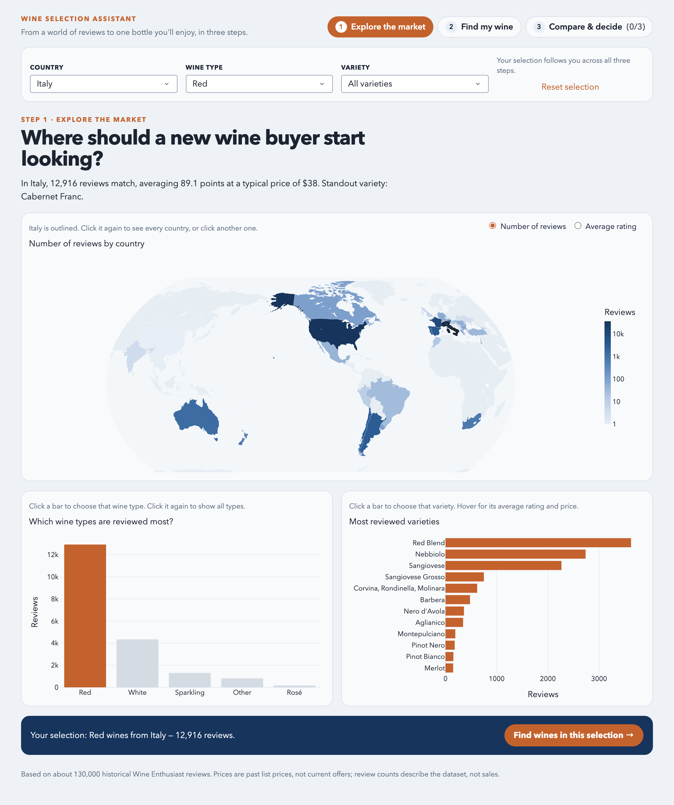
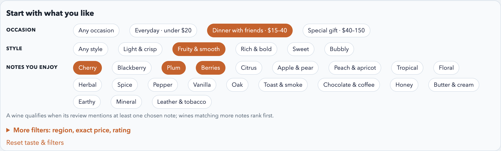
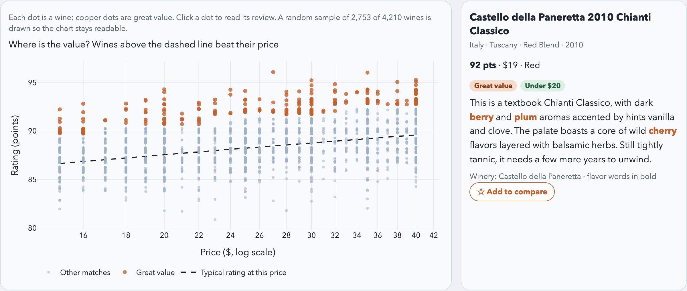
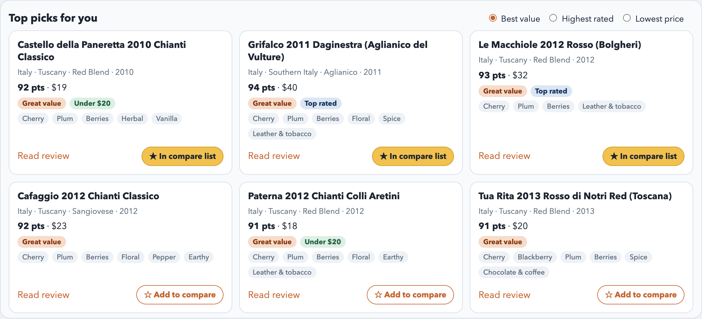
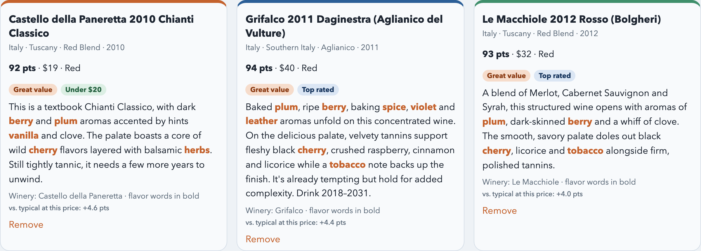
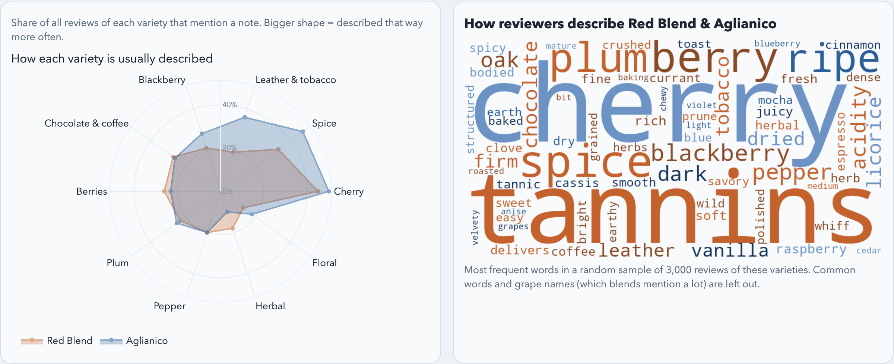

# Lab 4 Implementation Plan: Wine Selection Assistant

COMP7507 Visualization and Visual Analytics · Lab 4 (Vibe Coding) · Su Chuanzhou (3036837980)

## 1. Purpose

The Wine Selection Assistant is a three-page Plotly Dash application. It takes a beginner from "I want a good bottle but don't know where to start" to a short list of specific bottles and a reasoned choice between them. The interaction model and charts are built around that decision, not around showing every view of the data.

The application is a decision aid built on historical reviews. It does not cover current stock or prices. Review counts describe how many wines the dataset reviewed, not market share or popularity, and ratings are one magazine's critics' opinions.

## 2. Intended users and their questions

**Users:** beginner wine buyers. They usually know their budget, the occasion and roughly what they like ("fruity", "not too heavy"). They don't know which countries, grapes or labels deliver that.

| Stage | User question | Where it is answered |
|---|---|---|
| Orient | Where do most reviewed wines come from? Which types and grapes are common, and how are they rated? | Page 1 |
| Narrow | Which wines fit my occasion, budget and taste? Which are worth more than they cost? | Page 2 |
| Decide | How do my favourites differ? What do these grapes usually taste like? Is there something similar I missed? | Page 3 |

## 3. Data and preparation

Sources are `winemag-data-with-year.csv` (129,971 reviews) and `wine_category.csv` (variety → type), joined on `variety`.

- **Cleaning** (reused from my Lab 2 loader):
  - Trim text fields. Missing country, region and variety become "Unknown".
  - Convert prices and points to numbers.
  - Drop duplicate variety rows before the join so no review is duplicated. The single unmapped variety falls into "other".
  - Map the 43 countries to ISO-3 codes for the map, and show "US" as "United States".
- **Missing and implausible values:**
  - 8,996 reviews have no price. They still count on page 1, but price filters and the value score exclude them, and the interface says so.
  - 168 vintages outside 1900–2017 (e.g. 1000 or 7200, parsed from wine names) are treated as unknown.
- **Flavor tags (new):** 21 beginner-friendly notes (Cherry, Citrus, Oak, Earthy, …), each matched as word stems in the review text. 92% of reviews mention at least one. The tags drive the flavor filter, the badges on wine cards, the highlighted review text, the flavor radar and "similar wines".
- **Value score (new):** a quadratic fit of points on log(price) across all priced reviews gives the *typical rating at each price* (≈84.5 pts at $8, 88.2 at $25 and 91.9 at $100). A wine's value gap is its rating minus that typical rating. A gap of at least +3 points (about the top 10%) earns a **Great value** badge.

## 4. User workflow

1. **Explore:** on page 1, click a country on the map, a wine type and a variety. A shared "Your selection" bar (country, type, variety) stays at the top of every page, so these choices carry forward.
2. **Find:** on page 2, describe the occasion and taste with one-click chips. Then scan the value map, read reviews and star up to three candidates. The nav bar shows how many wines are starred, e.g. "Compare & decide (2/3)".
3. **Decide:** on page 3, see the starred wines side by side with a quick verdict, compare how their varieties are usually described, and optionally swap in a similar wine.

Users can move between steps at any time from the step navigation. "Reset selection" and "Reset taste & filters" undo choices. Empty results show advice instead of blank charts.

## 5. Pages

### Page 1: Explore the market (`/`)

**Purpose:** a quick, approachable overview that suggests where to look.

- **World map:** colour shows the number of reviews (log scale) or, via a toggle, the average rating. Hover shows reviews, average rating, median price and the most common variety. Clicking a country selects it and outlines it, and clicking it again deselects it.
- **"Which wine types are reviewed most?"** A bar chart of review counts for the selected country. Clicking a bar picks the type; the chosen bar stays copper and the others turn pale.
- **"Most reviewed varieties":** the top 12 varieties for the selected country and type, with average rating and median price on hover. Clicking a bar picks the variety.
- **Summary and next step:** one sentence summarises the selection (count, average rating, typical price, standout variety). A call-to-action band reads "Your selection: Red wines from Italy — 12,916 reviews" with a button to page 2.

### Page 2: Find my wine (`/find`)

**Purpose:** turn vague preferences into a short list, and show where the value is.

- **"Start with what you like":** instead of opening on a wall of sliders, beginners answer in plain language.
  - *Occasion* sets the price range: everyday (under $20), dinner with friends ($15–40) or special gift ($40–150).
  - *Style* sets the wine type and typical notes. For example, "Fruity & smooth" picks red with cherry, berries and plum.
  - *Notes you enjoy* can be edited freely. A wine qualifies when its review mentions at least one chosen note, and wines matching more notes rank higher.
  - Region, the exact price range (with "include over $150") and the rating range sit in a collapsible "More filters" panel.
- **Value map:** a scatter of price (log scale) against rating for the matching wines.
  - A dashed line marks the typical rating at each price. Copper dots above it are great value, and starred wines appear as yellow stars.
  - Ratings are whole numbers, so a small vertical jitter shows density.
  - Large selections use a random sample (up to 2,500 regular and 2,500 great-value wines), stated under the chart. This avoids the bias of plotting only the top-rated wines.
  - Clicking a dot opens its review in the side panel.
- **Review panel:** title, origin, rating, price, badges and the full review, with flavor words in bold, plus an "Add to compare" button.
- **"Top picks for you":** six cards ranked by *Best value*, *Highest rated* or *Lowest price* (wines matching more notes first). Each card shows badges (Great value / Top rated / Under $20), flavor tags, "Read review" and a star button.
- **"Every match" table:** all matching wines. Sorting and paging run on the server, so sorting by price really finds the cheapest of *all* matches, not just of a top subset. Selecting a row opens its review.

### Page 3: Compare & decide (`/compare`)

**Purpose:** support the final choice between at most three wines.

- **Quick verdict:** one sentence naming the highest-rated, the cheapest and the best-value starred wine.
- **Side-by-side cards:** origin, vintage, rating, price, badges, the gap to the typical rating, and the full review with flavor words highlighted. Each card has a "Remove" button.
- **Flavor radar, "How each variety is usually described":** for each starred wine's variety, the share of *all* reviews of that grape that mention each note, over the 10 most relevant notes. It answers "what does this grape usually taste like?" with the whole dataset behind it, which is more reliable than a single review.
- **Word cloud:** the most frequent words in a random sample of 3,000 reviews of the starred varieties. Common words and grape names (which blends mention constantly) are removed.
- **"You might also like":** for each starred wine, three alternatives. They must be the same type, within ±40% of the price and rated no more than 1 point lower (3 for top-rated wines with few peers). They are ranked by the overlap of their flavor tags with the starred wine (Jaccard similarity), with one per winery. Each can be starred straight away.
- **Empty state:** with nothing starred, the page explains the step and offers "Load 3 example picks" (the best-value wines of different varieties in the current selection).

## 6. Design decisions and how the plan changed

The plan went through three iterations with the AI assistant.

**Iteration 1: first prototype (two tabs).** Testing it exposed real problems:

- The price-vs-rating scatter plotted only the top 3,000 reviews by rating. With no filters it showed only 94–100 pt wines and hid the relationship it was meant to show.
- The table held only the top 1,000 by rating, so sorting by price reported a "cheapest" French wine of $18.
- The word list was dominated by filler words.
- Clicking the selected country again did nothing.

All four are fixed: random sampling with disclosure, server-side sorting over every match, a wine-aware stop list, and click-to-toggle with the click state cleared.

**Iteration 2: rebuilt on the Lab 2 codebase.** The lab allows continuing from Lab 2, so I reused its tested data loader, map with selected-country outline, filtering function and summary text. That kept the cleaning consistent and let the new work focus on the decision workflow.

**Iteration 3: "Find my wine" redesigned.** A review of the two-page plan found that page 2 was only filters plus charts. It showed data but did not help anyone decide. The final design:

- adds beginner-language taste chips, and puts the expert filters in a collapsible panel;
- replaces the plain scatter with a **value map** that answers "where are the bargains?";
- adds shortlist cards with a star action, and a third **Compare & decide** page for the final choice;
- drops the variety bubble chart (page 1 already covers varieties) and a redundant flavor-frequency bar chart. The word cloud moves to page 3, where "what does this grape taste like?" matters most.

Other principles applied throughout:

- One question per page.
- Every chart doubles as a selector.
- The same copper accent marks "chosen" or "good value" everywhere.
- Every sampled or limited view says so.
- Empty selections give advice instead of a blank chart.

## 7. Implementation

- **Stack:** Python 3, pandas, Plotly, Dash 4 with Dash Pages (real URLs per page) and `wordcloud`, in a `venv`. Dependencies are in `requirements.txt`.
- **Structure:**
  - `app.py`: navigation and the shared selection bar. It also holds the shared callbacks: keep the variety options valid, reset, and star/unstar. The compare list is kept in a session `dcc.Store`.
  - `src/data_loader.py`: cleaning, flavor tags, value score, filtering, ranking and similar wines.
  - `src/figures.py`: map, bars, value map and radar.
  - `src/text.py`: word counts, word cloud and highlighting.
  - `src/summaries.py`: sentences and wine cards.
  - `pages/explore.py`, `pages/find.py`, `pages/compare.py`: one layout and its callbacks per page.
- **Performance:** the data is loaded and tagged once at start-up (about 5 s). Filtering uses boolean masks, and the table returns one page at a time. The value map and word cloud are sampled. Each callback takes well under a second.

## 8. Testing

Tested in the browser at each step:

- Map, type-bar and variety-bar clicks update the shared selection, and clicking the same item again clears it.
- The selection survives switching pages (a bug where page 2 reset the wine type on load was found and fixed).
- Style and occasion chips set the type, notes and price.
- Star and unstar work from cards, the review panel and the similar-wine lists. The list caps at three, replacing the oldest. A bug where the same wine's star button appeared twice (card and review panel) with one ID, so a click was lost, was found and fixed.
- Table sorting and paging span all matches, and selecting a row opens the correct review.
- Value-map clicks open the clicked wine.
- Compare-page remove, empty state and example picks work.
- No browser console or server errors.

## 9. Limitations and future work

- **Flavor tags** come from keyword matching, so negations ("not oaky") still count as a mention. A tasting-note model or curated lexicon would be more accurate.
- **The value score** reflects this dataset's past list prices, not current shop prices.
- **Persistence:** the selection bar keeps its values across pages, but a hard browser refresh resets it. The compare list persists for the browser session.
- **Possible next steps:** food-pairing hints, a "why this pick" explanation on each card, and a small user study with beginners to check that the taste chips match how they describe wine.
