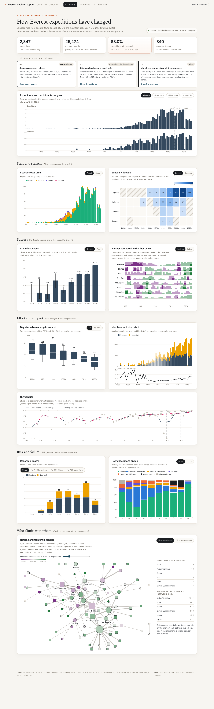

# Everest climbing decision support

COMP7507 Visualization and Visual Analytics · group 14 · project prototype.

An offline, single-page application that follows the proposal's three-module structure:

| Module | Question it answers |
|---|---|
| **01 History** | Did the mountain get easier? Scale, seasons, success compared with other peaks, duration, support, oxygen, risk under different denominators, how expeditions ended, and who climbs with whom. A timeline brush drives the page; an event explorer separates long-term change from the 2014, 2015 and 2020 interruptions. |
| **02 Routes** | Do side, route and timing matter? Filters drive the comparison, gap through time, route treemap, altitude funnel, summit calendar, 2D map and 3D terrain together. |
| **03 Your plan** | Does this apply to a given plan, and how far can it be trusted? An estimate with what-if ladder, the plan through time, factor heat map, index chart, factor network and matrix, decision-tree icicle, parallel coordinates of real expeditions, calibration. |

Each page has hypothesis cards ("Findings"); **Show the evidence** sets the charts to the state that shows it.
Core charts come first. Hypotheses and advanced analysis sit in native disclosure sections, and evidence links open the relevant section automatically.

Everything is computed from the local CSV snapshot and re-computed in the browser. There are **no network requests at runtime**.



*History — scale, success with Wilson intervals, season×decade, duration, support structure, oxygen, deaths.*

---

## Run it

Open `index.html` in a browser (double-click works; `file://` is fine). No build step, no server, no dependencies to install — D3 v7 is vendored in `vendor/`.

Tested with headless Chrome at 1440 / 1000 / 700 px. The page is responsive down to tablet width.

Optional deep links:

```
index.html?r_side=North&r_season=Autumn&r_period=t3#routes
index.html?age=40s&sex=F&season=Autumn&side=North&route=standard&team=20&hired=30&o2=1&tab=time#plan
index.html?from=2005&to=2024#history
index.html?finding=H7        (any of H1 to H8)
index.html?methods=1#history
index.html?selftest=1
```

Filters and profile choices are reflected in the URL so a scenario can be shared or screenshotted.

---

## Layout

```
everest-app/
├─ index.html                 the application shell
├─ css/app.css                design system + layout
├─ js/
│  ├─ util.js                 formatting, palette, axes, legends, timeline brush, horizon graph, findings
│  ├─ store.js                URL state and navigation between pages
│  ├─ module1.js              history view
│  ├─ history_events.js       sourced event explorer and fixed-window comparisons
│  ├─ network.js              page 1 nation and agency network, betweenness
│  ├─ module2.js              route explorer, funnel, treemap, calendar, 2026 layer
│  ├─ geo.js                  2D map with contours, 3D terrain, filter linking
│  ├─ plan_core.js            page 3 member table, shared period, matching rules
│  ├─ module3.js              profile form, estimate, what-if ladder, calibration, tabs
│  ├─ plan_time.js            plan through time, factor heat map, index chart
│  ├─ plan_links.js           factor network, adjacency matrix, decision-tree icicle
│  ├─ plan_records.js         parallel coordinates and closest expeditions
│  ├─ selftest.js             ?selftest=1 browser-vs-Python checks
│  └─ app.js                  tabs, lazy init, data & methods panel
├─ data/
│  ├─ everest_data.js         window.EVEREST_DATA (generated)
│  ├─ everest_data.json       same content, for debugging
│  ├─ model.js                window.EVEREST_MODEL (generated)
│  ├─ model.json              same content, for debugging
│  ├─ plan_data.js            anonymous member table, peak comparison, expected values (generated)
│  ├─ events.js               window.EVEREST_EVENTS (generated)
│  ├─ events.json             historical context, sources and fixed comparison windows
│  └─ terrain/                generated terrain layer
│     ├─ terrain.js           heightfield grid (260×300, base64 int16)
│     ├─ features.js          camps / cols / peaks from OpenStreetMap
│     ├─ terrain-shade.jpg    2D hillshade + hypsometric tint
│     ├─ terrain-color.jpg    3D texture (no baked shading)
│     └─ terrain-texture.js   same texture embedded for WebGL, so double-click opening works
├─ pipeline/
│  ├─ prepare.py              loading, cleaning, derived fields
│  ├─ build_data.py           aggregates + camps + 2026 layer → data/
│  ├─ train_model.py          two logistic regressions + evaluation + bootstrap → data/model.js
│  ├─ build_plan_data.py      member table, peaks, event expectations → plan_data.js + events.js
│  ├─ build_terrain.py        SRTM tiles → hillshade / texture / heightfield → data/terrain/
│  ├─ build_features.py       OpenStreetMap camps & peaks → data/terrain/features.js
│  └─ osm_features_raw.json   raw Overpass export (provenance)
└─ vendor/                    d3 v7 + three.js r149 (UMD, offline)
```

## Rebuild the data (only needed if the CSVs change)

```bash
cd pipeline
python3 build_data.py      # data/everest_data.js  (~660 KB)
python3 train_model.py     # data/model.js         (~75 KB, ~6 s)
python3 build_plan_data.py # data/plan_data.js     (~90 KB)
```

Requires Python 3 with pandas and numpy (and network access only for the SRTM tiles,
which are cached in `pipeline/.terrain_cache/`). The CSV snapshot lives in
`../Himalayan+Expeditions/`.

Full rebuild:

```bash
python3 build_data.py && python3 train_model.py && python3 build_plan_data.py
python3 build_features.py && python3 build_terrain.py
```

---

## Data rules worth knowing

These come from the data audit in `../proposal_check/` (28 checks, all documented there).

- **Year comes from the expedition record, never from `members.myear`.** The member
  table's own year field disagrees with its expedition in 34.8% of rows and in 96% of
  rows before 2000. Its season field, by contrast, matches all 89,000 rows.
- **`expid` is only unique together with the year.** `EVER21101` is both the 1921 and
  the 2021 expedition, `EVER22101` 1922/1922, `EVER24101` 1924/2024. Joins use
  `(peakid, year, expid)`. For those four collisions the member rows are assigned by
  `myear` when it matches a candidate year, otherwise to the earlier expedition
  (49 rows, marked in `prepare.py`).
- **Hired staff are only partly listed in the member table** (8,323 of the 15,533
  recorded hired personnel on Everest). Hired counts and rates therefore always use
  `tothired` / `smthired` at expedition level.
- **Success is defined once**: `success1` = at least one climber reached the summit on
  route 1. Member success (`msuccess`) is reported separately; the two disagree for
  40 of 2,347 expeditions.
- **Side is the host country** (Nepal = south, China = north). Route names are only
  used to separate the standard route from everything else and to build route
  families. There are 136 raw route strings.
- **No coordinates exist in the source.** `peaks.csv` has no latitude or longitude and
  the campsite field only contains dates and altitudes. The terrain view therefore adds
  SRTM elevation and OpenStreetMap camp positions; the line between camps stays schematic.
- **Closures are identified from the data's own notes.** Expeditions in 2014–15 with no
  summit whose `termnote` mentions the strike, an avalanche or the earthquake are flagged
  (130 expeditions). They stay visible in history charts and are left out of model fitting.

## The estimate

Two regularised logistic regressions on age band, recorded sex, season, side, route group,
team size, hired support and oxygen. Expeditions abandoned in the 2014–15 closures are excluded
from fitting, because many stopped before anyone would use oxygen and so inflated the oxygen effect.
That moved the member model's oxygen factor from about 69× to about 22× the odds.

| | Member model (headline) | Expedition model (context) |
|---|---|---|
| Target | member reached the summit (`msuccess`) | someone reached the summit on route 1 (`success1`) |
| Population | non-hired climbing members, 2005–2024, age 15–80, closures excluded | Everest expeditions 2005–2024 with ≥1 member, closures excluded |
| n | 8,075 | 1,365 |
| Base rate | 58.8% | 76.6% |
| L2 penalty | 1.0 | 1.0 |

- **Evaluation** follows the proposal's split: trained 1990–2014, validated 2015–2019,
  tested 2020–2024, compared against a constant-rate and a side×season baseline.
- **Deployment** coefficients are refitted on 2005–2024 because 1990s success rates are
  a different regime (21.6% member success in the 1990s vs 62.5% in 2020–2024).
- **Intervals** are 95% ranges from 300 bootstrap refits.
- **Comparable cohorts** are exact-match cells over the seven profile fields, with
  coarser fallbacks shown in the result card. Fewer than 10 exact matches returns
  *insufficient evidence* instead of a number, as promised in the proposal.

Held-out (2020–2024) performance:

| Member model | Brier | Log loss | AUC |
|---|---|---|---|
| Constant rate | 0.286 | 0.766 | 0.500 |
| Side × season | 0.253 | 0.699 | 0.476 |
| Logistic regression | 0.220 | 0.628 | 0.651 |

| Expedition model | Brier | Log loss | AUC |
|---|---|---|---|
| Constant rate | 0.156 | 0.500 | 0.500 |
| Side × season | 0.109 | 0.387 | 0.593 |
| Logistic regression | 0.044 | 0.188 | 0.942 |

Known limitations are listed in the app's **Data & methods** panel: the model has no time
term and under-predicts recent seasons overall (visible in the calibration chart), though
individual plans vary, which "Your plan through time" shows; oxygen is a near-perfect
separator whose coefficient should not be read causally; and all results are associations
in historical records rather than forecasts. Note also that "oxygen
used" and "hired staff above base camp" are recorded during an expedition rather than
entered as a plan; they are treated as plan attributes here, so the estimate describes
comparable historical expeditions rather than forecasting a future one.

## Decisions relative to the proposal

| Proposal said | Built | Why |
|---|---|---|
| MapLibre GL JS with 3D terrain and verified waypoints | 2D hillshade map + interactive 3D WebGL terrain, camps from OpenStreetMap | The expedition CSV has no coordinates, so the terrain comes from public SRTM 30 m tiles (Mapzen / AWS Open Data) and camp/col/peak positions from OpenStreetMap (ODbL). The dashed route line between camps remains schematic; everything is offline. |
| "Estimate recorded expedition summit success" | Member-level probability headline, expedition-level context | Age and sex only exist at member level. A single expedition-level target cannot legitimately use a personal profile; showing both keeps the promise and stays coherent. |
| 1990–2014 / 2015–2019 / 2020–2024 training split | Same split for evaluation; deployment refit on 2005–2024 | Success rates drift strongly by era; a 1990s-trained intercept is ~20 points too low for current planning. |
| Route names as a filter | Route families grouped by leading name | 136 raw strings fragment the data into cells with n<10; families keep every rate backed by 20+ expeditions. |
| "Sparse profiles return insufficient evidence" | Exact-cell n<10 → no number, single-change suggestions shown instead | Implemented as promised. |
| "Only variables available before an expedition" | Oxygen and hired staff are recorded during it and used as plan attributes; closures excluded from fitting | No cleaner fields exist. Stated openly in Data & methods. |

## QA checklist

- Counts in module 01 match the audited figures (2,347 expeditions, 25,274 member
  records, 1,479 successful, 340 deaths).
- Every rate shows numerator, denominator and sample size; sparse cells are hatched and
  carry n in the tooltip.
- Module 02 recomputes from the 2,347 expedition rows for every filter combination and
  shows empty states instead of zeros for missing data.
- The terrain layer was verified by plotting known coordinates on the rendered hillshade
  (summit, both base camps, cols) before integrating it.
- Module 03's model predictions were cross-checked in Python against the browser
  (default profile: 74.6% model vs 75.0% observed in the exact cohort). The same comparison is now
  automated: open `?selftest=1` for 59 browser-vs-Python checks (counts, predictions, cohort sizes,
  camp ordering, plan data, every finding's numbers, and every event's fixed-window totals).
- Insufficient-evidence path tested with a winter / north / non-standard / no-oxygen
  profile.
- No console errors on any view; no network requests; D3 vendored locally. Palette checked with a colour-blind simulation; meaning never relies on hue alone.

## Provenance

- Data: **The Himalayan Database** (Elizabeth Hawley), distributed by
  **Maven Analytics**, snapshot `exped.csv` dated 2025-04-29.
- Terrain: SRTM 30 m via **Mapzen / AWS Open Data Terrain Tiles**
  (https://registry.opendata.aws/terrain-tiles/).
- Camps, cols and peaks: **© OpenStreetMap contributors** (ODbL), exported via the
  Overpass API (`pipeline/osm_features_raw.json`).
- 2026 spring aggregate figures: Kathmandu Post (2026-05-29) and Radio Nepal
  (2026-06-10). They are shown as a separate layer and never merged into the
  historical data or the model.
- SHA-256 checksums for all five CSVs are embedded in `data/everest_data.js` and shown
  in the app's Data & methods panel.
- The full data audit is in [`../proposal_check/proposal_data_check_report.md`](../proposal_check/proposal_data_check_report.md).
- Screenshots of all views are in [`docs/screens/`](docs/screens/).
