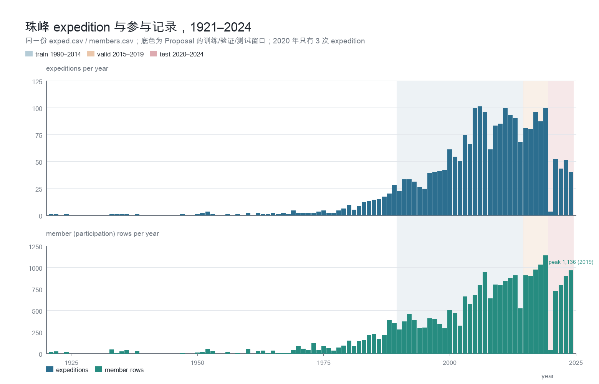
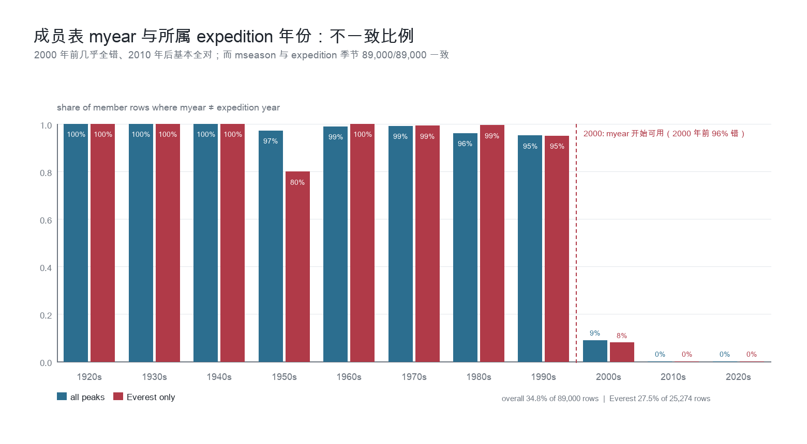
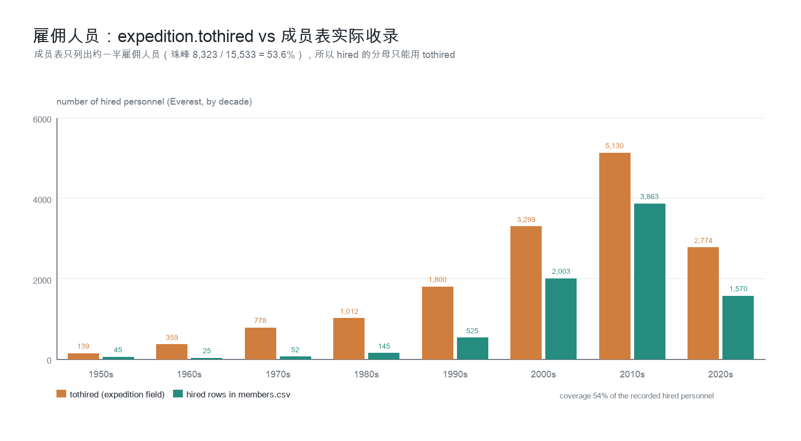
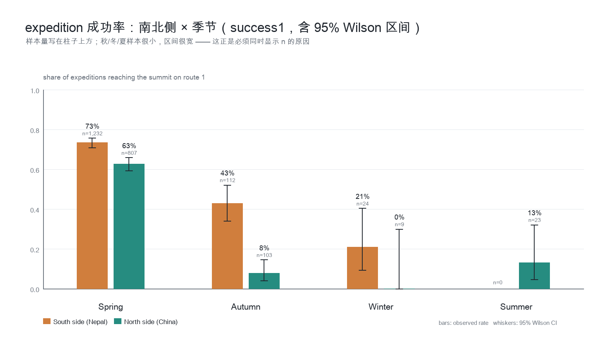

# COMP7507 Group 14 · Proposal 数据核验报告

> **核验对象**：`Proposal(1).docx` / `Proposal.pdf`（2026-10-09 版）Part B 全部可核验的数据陈述
> **数据**：`Himalayan+Expeditions/`（Maven Analytics 快照，文件时间 2025-04-29）
> **核验时间**：2026-10-17
> **可复现**：`verify_proposal_claims.py`（28 条核验）、`make_figures.py`（4 张图）
> **原始数据未被修改**，只读取。

---

## 0. 一句话结论

**提案里的数字全部是对的**：6 个硬数字 + 1 个年份区间（11,425 / 89,000 / 480 / 15,586 / 2,347 / 25,274 / 1921–2024）逐一对上，键结构、参与记录与人数、无坐标、死亡数、格式要求也全部成立——**没有一条是编的或算错的**。

真正需要动的是三类"限定"，不是改数字：

| 类型 | 数量 | 说明 |
|---|---|---|
| ✅ 通过 | 17 条 | 数字、键、口径、引用、格式 |
| ⚠️ 建议补一句 | 11 条 | 其中 **3 条影响高**（会改变结论口径或做不出来） |
| ❌ 写错 | 0 条 | — |

> **怎么读**：只关心"数字对不对" → §1 + 附录 A；准备动手实现 → 先看 §2 的三个坑。

三个高影响点：**① `members.myear` 在 2000 年前几乎全错；② 雇佣人员只被登记了一半，hired 率算错会高估近一倍；③ "summit success" 有 3 种口径，必须先写死一个。**

---

## 1. 硬数字与键结构（全部通过）

| 提案原文 | 复算方式 | 实测 | 结论 |
|---|---|---|---|
| 11,425 expedition records | `len(exped.csv)` | **11,425** | ✅ |
| approximately 89,000 member records | `len(members.csv)` | **89,000**（正好，可去掉 approximately） | ✅ |
| 480 peaks | `len(peaks.csv)` | **480** | ✅ |
| 15,586 references | `len(refer.csv)` | **15,586**（文件 15,587 行 = 表头 + 15,586） | ✅ |
| Everest filtering → 2,347 expeditions | `peakid == 'EVER'` | **2,347**（`peaks` 里 Everest 只有 `EVER` 一个 ID，不会漏算） | ✅ |
| 25,274 participation records | `members.peakid == 'EVER'` | **25,274** | ✅ |
| from 1921 to 2024 | min/max | **1921–2024**（exped 与 members 两端一致） | ✅ |
| expid contains a two-digit year | `expid[len(peakid):+2] == year[-2:]` | **11,425 / 11,425 = 100%** | ✅ |
| composite key (peak, year, expid) | `duplicated()` | expid 单独 **4 个 ID 各出现两次**；(peakid, year, expid) **0 行重复** | ✅ |
| membid is expedition-local | 取值范围 / 跨队重复 | **1–99**，跨 expedition 重复；(expid,membid) 有 35 对、共 70 行重复，全部来自上面的撞号 | ✅ |
| participation rows are not unique climbers | distinct(fname,lname,yob) | **13,283 人 / 25,274 人次 ≈ 53%** | ✅ |
| no route geometry / camp coordinates / terrain | 字段检查 | 两张表都**没有 lat/lon**；`campsites` 2,319 条非空，其中 **2,158 条含海拔、0 条含经纬度** | ✅ |
| recorded deaths | `mdeaths` + `hdeaths` | **208 + 132 = 340**，与成员行 `death=True` 完全对齐 | ✅ |
| rates state numerator, denominator, unit | 表内计数 vs 成员行 | `totmembers` **98.9%** 精确相等、`smtmembers` **99.9%** 精确相等、死亡数 **100%** 相等 | ✅ |
| Times New Roman 12pt black, Part B ≤ 5 pages | docx 样式 + PDF 页数 | TNR 12pt、黑色、**PDF 共 5 页** | ✅ 合规 |

> 最有说服力的一条：`expid` 真的会在跨世纪撞号，而且撞得很整齐——
> `EVER21101` = **1921** 和 **2021**，`EVER22101` = **1922** 和 **2022**，`EVER24101` = **1924** 和 **2024**，`KANG10101` = 1910 和 2010。
> 这正好证明提案里"用复合键 + duplicate checks"不是空话。**建议把 EVER21101 这个例子直接写进提案**，比泛泛说 "composite key" 有说服力得多。



---

## 2. 三个高影响坑（数字没错，但实现会踩）

### 2.1 `members.myear` 不能用——2000 年前几乎全错



- 全表 **30,930 / 89,000 = 34.8%** 的行，`myear` ≠ 所属 expedition 的年份；珠峰 **6,947 / 25,274 = 27.5%**。
- 分年代看很清楚：**2000 年以前 96.1% 全错**（珠峰 96.7%），2000 年以后 3.2%（珠峰 2.7%；2000s 8.9%，2010s 之后 0%）。
- 反证：`mseason` 与 expedition 季节 **89,000 / 89,000 完全一致** → 季节字段是好的，坏的是年份字段。
- 交叉验证：**15,761 / 59,731** 行的 `myear` 与本人 `msmtdate1` 的年份矛盾。
- 具体例子：1973 年意大利队（Guido Monzino）的 65 名队员，`myear` 全被写成 **1995**，而他们的登顶日期是 1973-05-05。
- 后果：如果按 `age = myear - yob` 做年龄分箱，会出现 **385 行 <10 岁、54 行 >80 岁**（最小 **−41**、最大 **118**）；改用 expedition 年份后是 **12–86 岁**（中位 36），完全干净。

**修法（脚本里已实现）**：年份一律从 `exped` 表取；只有 4 个撞号 expid 需要判断归属——`myear` 命中候选年份就用它，否则归入较早那年。回填后 1921/1922/1924 三队的队员数分别与 `totmembers` **9 / 13 / 11 完全吻合**，只有 49 行属于"推断"（脚本里标记为 ambiguous）。

**建议在 Part B 补一句**：年份取 expedition 表、成员表年份字段只用于撞号消歧（见 §5 句 2）。

---

### 2.2 雇佣人员只被登记了一半——hired 率会算错一倍



- `exped.tothired` 合计 **35,952** 人，但成员表里只有 **19,971** 行 `hired=True`（**55.5%**）；珠峰 **8,323 / 15,533 = 53.6%**。
- 覆盖率并不单调：1950s 32%、1960s–70s 7%、1980s 14%、1990s 29%、2010s 75%、2020s 57%。**1990 年以前的 hired 个体数据基本不可用。**
- 后果非常直观：如果用成员行算 hired 成功率，得到 **77.5%**（只有登顶者常被登记，幸存者偏差）；用 `smthired / tothired` 算，只有 **42.5%**（6,595 / 15,533）。**两个数差了一倍。**
- 修法：hired 的分子分母都用 expedition 字段（`smthired` / `tothired`）；成员行只用于"谁被登记到了"，不能拿来当分母。

**建议在 Part B 补一句**：hired 计数与率来自 expedition 字段（见 §5 句 3）。

---

### 2.3 "summit success" 必须先定义

数据里有三种"成功"，数值差别很大：

| 口径 | 字段 | 珠峰数值 |
|---|---|---|
| expedition 级（route 1 上有人登顶） | `success1` | **1,479 / 2,347 = 63.0%** |
| 队员级（个人是否登顶） | `msuccess` / `smtmembers` | **6,279 / 17,199 = 36.5%** |
| 雇佣人员级 | `smthired` / `tothired` | **6,595 / 15,533 = 42.5%** |

`success1` 与 `smtmembers > 0` 有 **40 / 2,347（1.7%）不一致**：29 次是"只有雇佣人员登顶"，11 次是"走 route 2 登顶"（`success2=True`）。所以 `success1` 严格说不是"队伍成功"，而是"route 1 上有人登顶"。

**建议**：界面和报告里写死一个主口径（推荐 expedition 级 `success1`），队员级另列，并在 tooltip 里永远带 `分子/分母/n`。提案里"All views will distinguish counts from rates and show sample sizes"已经写了原则，补一句具体定义即可（见 §5 句 4）。

---

## 3. 需要补限定的陈述

### 3.1 侧别与季节（C14 / C15）



- `route1` 有 **136 种写法**，前两个（`S Col-SE Ridge` 1,308 + `N Col-NE Ridge` 784）就占 **89.1%**。
- **"climbing side" 不是现成字段**：按 route 名称归类得 南 1,368 / 北 942 / **无法归类 37**；和 `host`（Nepal 1,409 / China 938）的一致率 **98.5%**。`Lho La-W Ridge` 这类西藏/尼泊尔边界的线路会天然歧义。
- **建议**：`host` 当 side 的主口径（完整、无歧义），route 名称只用于 route group，剩下 37 条显式标 `Other`。
- 季节极不平衡：Spring **2,059** / Autumn **230** / Winter **34** / Summer **24**。秋季南北差异巨大（南 42.9% vs 北 7.8%），但北侧秋季只有 103 次，Wilson 区间很宽——**图上必须同时给 n**，否则很容易被读成"北坡秋天就是不行"。

### 3.2 模型可行性（C18 / C19 / C20）

- **年龄**：`yob` 缺 1,309 / 25,274（5.2%）；用 expedition 年份算年龄是干净的（12–86，中位 36），前提是按 §2.1 修年份。
- **性别**：M 23,129 / F 2,144 / X 1 —— 女性样本只占 8.5%，分性别建模要注意样本量。
- **氧气**：**76.3%（1,791 / 2,347）** 的 expedition 都用氧，方差很小，而且和年代强共线。它在回归里很容易变成"年代代理"，解释时要明说。
- **切分**：1990–2014 **1,511** 次 / 2015–2019 **443** 次 / 2020–2024 **189** 次。**2020 年只有 3 次 expedition**（疫情），所以 2020–2024 测试集实际是 2021–2024；且三段成功率从 62.9% → 67.5% → 88.9%，存在明显的年代漂移，**建议测试集改成 2021–2024 或改用滚动时间验证**。

### 3.3 文案级（C13 / C25 / C28）

- **缺失率**：`smtdays` 缺 252（10.7%）、`totdays` 缺 461（19.6%）、`bcdate` 236（10.1%）、`smtdate` 77（3.3%）、`campsites` 28（1.2%）；`success1` / `totmembers` / `tothired` / `o2used` / `highpoint` **零缺失**。时长类图必须标 n。
- **"2025-2026 aggregate"**：本地快照止于 **2024**；引用的 [5][6] 都是 **2026 年春季**，没有 2025 年来源 → 建议改成 "the 2026 spring season"。
- **数据字典有 bug**：`refer` 表的描述从 `ryear` 起整体**错位一列**（`ryear` 被描述成 "Reference type"，`rtype` 被描述成 "Journal / magazine type"……）。做字典页时要手工修。

---

## 4. 外部引用与格式（通过）

| 检查项 | 结果 |
|---|---|
| [1] himalayandatabase.com | HTTP 200 |
| [2] Maven Analytics 数据页 | HTTP 200 |
| [4] Himalayan Database season lists | HTTP 200 |
| [5] Radio Nepal（2026-06-10） | HTTP 200；标题、Rs **1.26 billion**、**495** 份珠峰许可、**1,195** 人/31 座峰，均与提案描述一致 |
| [6] Kathmandu Post（2026-05-29） | HTTP 200；**1,008** 人登顶，与标题一致 |
| [6] 里"上一个纪录约 900" | 本地数据 **2019 年 = 899**（`smtmembers + smthired`）→ 自洽，可作为可信度旁证 |
| docx 字体/字号/颜色 | Times New Roman **12pt**、黑色 `#000000` |
| 页数 | PDF **5 页**（正好压线，别再加了） |

---

## 5. 可直接替换的英文句子

> 插到对应位置即可，语气与提案一致。

1. **Dataset Description（复合键那段之后）**
   > Duplicate checks confirm four expedition IDs that occur in two different years—for example, EVER21101 denotes both the 1921 and the 2021 expedition—so every join uses the composite key (peakid, year, expid).

2. **Dataset Description（同段）**
   > Member-level year is taken from the expedition record: the member table's own year field disagrees with its expedition in 34.8% of rows, and in 96% of rows before 2000, whereas its season field matches all 89,000 rows.

3. **Module 1 / rates**
   > Hired counts and rates use the expedition-level tothired and smthired fields, because the member table lists only about half of the recorded hired personnel (8,323 of 15,533 on Everest), which would otherwise bias hired success upward.

4. **Module 3**
   > An expedition is counted as successful when success1 is true, meaning at least one climber reached the summit on route 1; member-level success (msuccess) is reported separately, since the two definitions disagree for 40 of 2,347 Everest expeditions.

5. **Module 2 / current situation（如果想保留 2025-2026 的说法）**
   > Current indicators cover the 2026 spring season, the most recent completed season reported by Nepal's Department of Tourism.

---

## 6. 复现方式

```bash
cd "assignment/A1/proposal_check"
python3 verify_proposal_claims.py   # 28 条核验 → claim_checks.csv + key_numbers.json
python3 make_figures.py             # 4 张图 → figs/
```

产物：

| 文件 | 内容 |
|---|---|
| `claim_checks.csv` | 28 条核验表（含方法、实测值、结论、影响程度、备注） |
| `key_numbers.json` | 全部实测数字、SHA-256、撞号清单、分年代统计 |
| `figs/fig1_everest_yearly.png` | 1921–2024 逐年规模 + 训练/验证/测试窗口 |
| `figs/fig2_side_season_success.png` | 南/北 × 季节成功率 + 95% Wilson 区间 |
| `figs/fig3_myear_mismatch.png` | myear 错配率（2000 年分界） |
| `figs/fig4_hired_gap.png` | tothired vs 成员行收录量 |

文件校验（可用于提案承诺的 "file checksums recorded"）：

| 文件 | 行数 | SHA-256 |
|---|---|---|
| `exped.csv` | 11,425 | `c90c2c8a3959fdb5b05183887f1879501b9832d3980369254cb9ecce318e665d` |
| `members.csv` | 89,000 | `e71268329b30f37c0129b3eb29737f89be5f64891cf3ccca531da7ba8cce34be` |
| `peaks.csv` | 480 | `6280f01676c0625a3bc9745af3f08031593bbdf55f0e1fd1095f12d636c1fc18` |
| `refer.csv` | 15,586 | `d44a79a91f8c12c9d386a63d964ef961cd774baad6b63eaa5e40b0a5192652c0` |
| `himalayan_data_dictionary.csv` | 165 | `43aa305676169cdae8a906643a6fe91006631db01ede40e719959a0bdb80988e` |

---

## 附录 A：28 条核验表

| # | 提案陈述 / 核验对象 | 实测 | 结论 | 影响 |
|---|---|---|---|---|
| C01 | 11,425 expedition records | 11,425 | ✅ 一致 | — |
| C02 | approximately 89,000 member records | 89,000 | ✅ 一致 | — |
| C03 | 480 peaks | 480 | ✅ 一致 | — |
| C04 | 15,586 references | 15,586 | ✅ 一致 | — |
| C05 | Everest filtering gives 2,347 expeditions | 2,347 | ✅ 一致 | — |
| C06 | 25,274 participation records | 25,274 | ✅ 一致 | — |
| C07 | from 1921 to 2024 | 1921–2024 | ✅ 一致 | — |
| C08 | Participation rows are not unique climbers | 13,283 人 / 25,274 人次 | ✅ 一致 | — |
| C09 | The expedition identifier also contains a two-digit year | 11,425 / 11,425 | ✅ 一致 | — |
| C10 | linked with a composite key (peak, year, expedition identifier) | expid 单独 4 个 ID 重复；(peakid,year,expid) 0 行重复 | ✅ 一致 | — |
| C11 | the member identifier is expedition-local | membid 1–99，跨 expedition 重复 | ✅ 一致 | — |
| C12 | no complete route geometry, camp coordinates, or terrain model | 无 lat/lon；campsites 2,319 条非空、2,158 条含海拔、0 条含经纬度 | ✅ 一致 | — |
| C13 | seasonal composition / duration / oxygen / deaths | smtdays 缺 252（10.7%）、totdays 缺 461（19.6%）；o2used 0 缺失 | ⚠️ 需限定 | 中 |
| C14 | compare climbing side, route group, season | 136 个 route1；南 1,368 / 北 942 / Other 37 | ⚠️ 需补充 | 中 |
| C15 | season comparison | Spring 2,059 / Autumn 230 / Winter 34 / Summer 24 | ⚠️ 需限定 | 中 |
| C16 | route comparison (duration, team size, oxygen, success, risk) | 1,479 / 2,347 = 63.0% | ✅ 可用 | — |
| C17 | estimate recorded expedition summit success | 40 次（1.7%）不一致：29 次只有 hired 登顶、11 次走 route2 | ⚠️ 需补充 | **高** |
| C18 | age band / recorded sex predictors | yob 缺 1,309（5.2%）；年龄 12–86；M 23,129 / F 2,144 | ⚠️ 需补充 | 中 |
| C19 | planned oxygen use | 1,791 / 2,347 = 76.3% 用氧 | ⚠️ 需补充 | 中 |
| C20 | split 1990-2014 / 2015-2019 / 2020-2024 | 1,511 / 443 / 189（2020 仅 3 次） | ⚠️ 需改 | 中 |
| C21 | hired support / team size | 35,952 vs 19,971（珠峰 15,533 vs 8,323） | ⚠️ 需补充 | **高** |
| C22 | recorded deaths | 208 + 132 = 340 | ✅ 一致 | — |
| C23 | rates always state numerator, denominator, unit | totmembers 98.9%、smtmembers 99.9%、死亡 100% 对齐 | ✅ 可支撑 | — |
| C24 | records will be linked ... after duplicate checks | 30,930 / 89,000 行 myear 不一致（34.8%；珠峰 27.5%） | ⚠️ 需补充 | **高** |
| C25 | current 2025-2026 aggregate indicators | 快照止于 2024；[5][6] 均为 2026 春季 | ⚠️ 需限定 | 低 |
| C26 | current snapshot / season lists | [1][2][4][5][6] 均 200；1,008 人、1.26 billion 卢比 | ✅ 一致 | — |
| C27 | TNR 12pt black, Part B ≤ 5 pages | TNR 12pt 黑色；PDF 5 页 | ✅ 合规 | — |
| C28 | data dictionary in the data folder | refer 段描述从 ryear 起错位一列 | ⚠️ 需补充 | 低 |

## 附录 B：口径备忘

- **expedition 级成功**：`success1`（route 1 上有人登顶），2,347 次中 1,479 次。
- **队员级成功**：`msuccess` 或 `smtmembers / totmembers`（17,199 名队员中 6,279 人登顶）。
- **雇佣人员级**：`smthired / tothired`（15,533 人中 6,595 人登顶）；**不要**用成员行做分母（只收录 53.6%）。
- **年份**：来自 `exped` 表；4 个撞号 expid（EVER21101 / EVER22101 / EVER24101 / KANG10101）用 `myear` 命中候选年份消歧，否则归较早年份（49 行）。
- **侧别**：建议用 `host`（Nepal 1,409 / China 938）；route 名称只做 route group。
- **所有比例**：一律同时给分子、分母、n；季节、侧别、年代的子样本量差异很大，区间必须一起显示。
